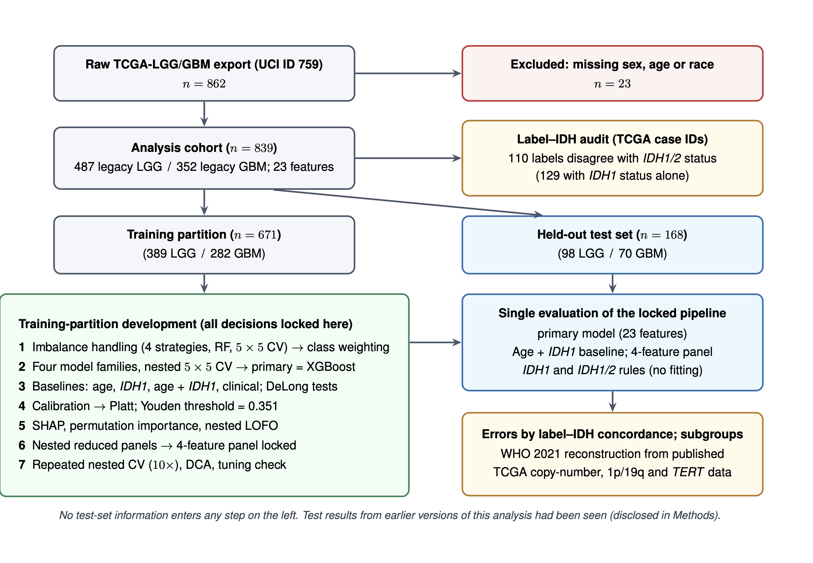
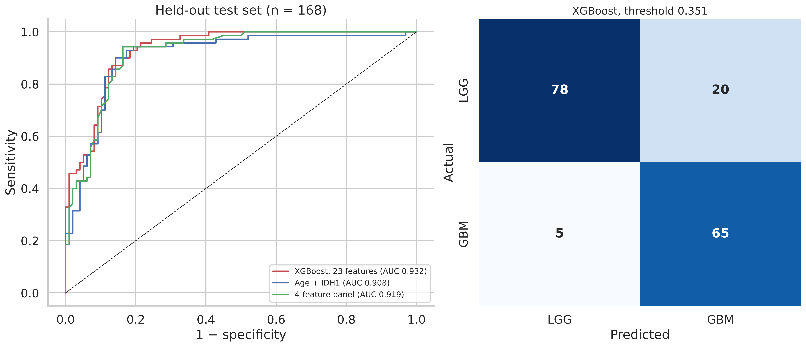
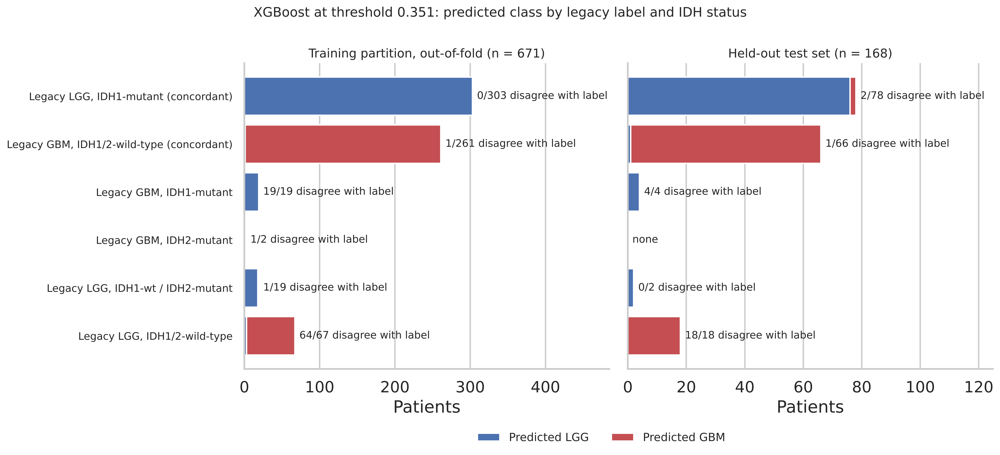

<div align="center">

# Glioma-Classification

### Diagnostic Label–IDH Discordance and Machine-Learning Classifier Performance on a Legacy TCGA Glioma Grading Benchmark

[](https://github.com/SandeepSinghNk/Glioma-Classification/releases/tag/v3.0.0)
[](environment/requirements-lock.txt)
[](LICENSE)
[](Data/DATASHEET.md)
[](Results/ManuscriptNumbers.csv)

**Sandeep Singh<sup>1</sup>, Ashok Pal<sup>1</sup>, Nitin Mittal<sup>2</sup>, Jatinder Kaur<sup>3</sup> & Fikreselam Gared<sup>4,*</sup>**

<sup>1</sup>Department of Mathematics, University Institute of Sciences, Chandigarh University, Mohali, Punjab, India  
<sup>2</sup>Department of Industry 4.0, Skill Faculty of Engineering & Technology, Shri Vishwakarma Skill University, Palwal, Haryana, India  
<sup>3</sup>Department of Electronics and Communication Engineering, GLA University, Mathura, Uttar Pradesh, India  
<sup>4</sup>Faculty of Electrical and Computer Engineering, Bahir Dar Institute of Technology, Bahir Dar University, Bahir Dar, Ethiopia  
<sup>*</sup>Corresponding author: `fikreselam.gared@bdu.edu.et`

[**Overview**](#-overview) •
[**Key Findings**](#-key-empirical-findings) •
[**Workflow & Architecture**](#-study-design--engineering-architecture) •
[**Benchmark Results**](#-headline-benchmark-results) •
[**WHO 2021 Label Release**](#-who-2021-patient-level-label-release-v10) •
[**Quickstart**](#-quickstart--reproducibility) •
[**Repository Structure**](#-repository-layout) •
[**Citation**](#-citation)

</div>

---

> [!IMPORTANT]
> **Research Use Disclaimer:** Neither the trained machine-learning classifiers nor the post hoc reconstructed WHO 2021 categories in this repository are intended for clinical diagnosis, prognostic stratification, or patient management. All reconstructed categories are approximate research annotations derived from public archival data.

---

## 📌 Overview

The **UCI/TCGA Glioma Grading Clinical and Mutation Features** dataset ([UCI ID 759](https://doi.org/10.24432/C5R62J); $n = 839$ complete-case patients, 20 somatic mutation indicators, age, sex, and race) is one of the most widely used tabular benchmarks in neuro-oncology machine learning. Published studies routinely evaluate competing classifiers and feature-selection pipelines on its binary **LGG vs. GBM** target and report accuracies clustering tightly around **85.7%–87.6%**.

This repository provides the complete reproducible codebase, pre-test cryptographic decision locks, audited result tables, and **version 1.0 of a patient-level WHO 2021 label reconstruction** demonstrating why classifiers plateau on this benchmark:

1. **The target is a legacy WHO 2007 histological project label** (`TCGA-LGG` vs. `TCGA-GBM`) assigned prior to the integration of *IDH1*/*IDH2* mutation status and molecular glioblastoma criteria into the WHO classification of CNS tumors.
2. **13.1% of benchmark labels (110 / 839) disagree with *IDH1*/*IDH2* status** (85 IDH-wildtype legacy LGG and 25 IDH-mutant legacy GBM), meaning the zero-parameter rule *`"IDH1/2-wildtype ⇒ GBM"`* achieves **86.9% accuracy** without fitting a single parameter.
3. **Within the 23 released features, the learning algorithm is not the bottleneck:** under leakage-free $5\times 5$ nested cross-validation and locked held-out evaluation, gradient-boosted trees (`XGBoost`), penalized logistic regression, and random forests perform similarly, and none significantly outperforms the zero-parameter *IDH1/2* rule ($p = 0.25$).

---

## 🔬 Key Empirical Findings

| Dimension | Empirical Finding | Evidence & Location |
| :--- | :--- | :--- |
| **1. Label–IDH Discordance** | **110 of 839 patients (13.1%)** have legacy labels discordant with *IDH1*/*IDH2* mutation status (85 IDH-wt LGG; 25 IDH-mut GBM). Against *IDH1* alone, **129 of 839 (15.4%)** are discordant due to 21 *IDH2*-mutant LGG cases. | [`Table28_WHO2021_DiscordanceSummary.csv`](Results/Tables/Table28_WHO2021_DiscordanceSummary.csv) |
| **2. Model-Free WHO 2021 Audit** | Linking all 839 patients via TCGA `Case_ID` to published annotations ([Ceccarelli et al., *Cell* 2016](https://doi.org/10.1016/j.cell.2015.12.028)) shows that **68 of 85 (80.0%)** IDH-wildtype legacy LGG meet WHO 2021 molecular criteria for *glioblastoma, IDH-wildtype* (*TERT*p mutation, *EGFR* amplification, or $+7/{-}10$), ranging from **51.8% to 84.0%** across 10 sensitivity variants (**64/85 [75.3%]** under cIMPACT-NOW Update 11 caution; **45/85 [52.9%]** requiring $\ge 2$ criteria). | [`Table35a_ReconstructionSensitivity_Counts.csv`](Results/Tables/Table35a_ReconstructionSensitivity_Counts.csv)<br>[`Table36b_cIMPACT11_Variants.csv`](Results/Tables/Table36b_cIMPACT11_Variants.csv) |
| **3. External Concordance** | Compared against the independent TCGA WHO 2021 reclassification of [de Mendonça et al. (*Nat. Commun.* 2025)](https://doi.org/10.1038/s41467-025-59188-3) (`MONET` commit `177a5a4`), our base reconstruction agrees in **811 of 816 mutually assigned patients (99.4%)** (4-category Cohen's $\kappa = 0.990$; binary GBM-IDHwt $\kappa = 0.988$), with all 5 disagreements arising solely from IDH source differences. | [`Table37e_DeMendoncaComparison.csv`](Results/Tables/Table37e_DeMendoncaComparison.csv)<br>[`Table37f_DeMendoncaDisagreements.csv`](Results/Tables/Table37f_DeMendoncaDisagreements.csv) |
| **4. Tumor Type vs. Grade** | All **23 of 23** assessable non-codeleted IDH-mutant legacy GBM are *astrocytoma, IDH-mutant, CNS WHO grade 4*, and **21 of 25** lack *CDKN2A/B* homozygous deletion (graded 4 on histological necrosis/microvascular proliferation alone). Thus, **tumor-type errors** largely reflect outdated labels (**72/79** dev and **19/24** test errors agree with reconstructed type), whereas **grade errors** reflect missing histological features (**52/78** dev and **16/23** test errors agree with grade 4). | [`Table33_WHO2021_Reconstruction.csv`](Results/Tables/Table33_WHO2021_Reconstruction.csv)<br>[`Table35b_ReconstructionSensitivity_ModelAndRule.csv`](Results/Tables/Table35b_ReconstructionSensitivity_ModelAndRule.csv) |
| **5. Richer Molecular Features** | Adding WHO 2021-defining copy-number (*EGFR* amp, *CDKN2A/B* del, $+7/{-}10$) and 1p/19q co-deletion features ($n = 820$ complete cases) modestly raises out-of-fold ROC-AUC from **0.916 to 0.923** ($p = 0.13$) but does not materially improve legacy-label accuracy (**0.874** vs. **0.869** for the *IDH1/2* rule; test McNemar $p = 1.0$). | [`Table38_RicherFeatureCeilingTest.csv`](Results/Tables/Table38_RicherFeatureCeilingTest.csv) |

---

## 🏗️ Study Design & Engineering Architecture

<p align="center">
  
</p>

### Methodological & Reproducibility Safeguards

- **Strict Partition Hygiene & Pre-Test Locking:** The 839-patient cohort is split 80/20 (`seed = 42`, stratified by legacy label) into a **Training Partition ($n = 671$: 389 LGG, 282 GBM)** and a **Held-Out Test Partition ($n = 168$: 98 LGG, 70 GBM)**. All 5 modeling decisions—(1) class weighting, (2) primary estimator (`XGBoost`), (3) cross-fitted Platt scaling, (4) Youden threshold ($t = 0.351$), and (5) reduced 4-feature panel (`IDH1`, `Age`, `IDH2`, `TP53`)—are locked on the training partition and serialized to [`Results/Models/locks_before_test.json`](Results/Models/locks_before_test.json) before test scoring.
- **Fully Nested Cross-Validation & Ablations:** Hyperparameter tuning ($5\times 5$ nested CV, 25 randomized candidates per outer fold), Leave-One-Feature-Out (LOFO) ablations, and reduced-panel selection re-tune hyperparameters strictly inside each outer fold with Holm–Bonferroni multiplicity correction.
- **Single Source of Truth (`ManuscriptNumbers.csv`):** Every single statistic, count, confidence interval, and $p$-value cited in the manuscript and Supplementary Information (703 keys across 81 generated assets) is programmatically written to [`Results/ManuscriptNumbers.csv`](Results/ManuscriptNumbers.csv) and verified via automated audit script.
- **Cryptographic Input & Release Verification:** All external cBioPortal (`lgggbm_tcga_pub`, datahub commit `18763f8`) and MONET (`commit 177a5a4`) files are verified against pinned SHA-256 digests.

---

## 📊 Headline Benchmark Results

### 1. Model Families & Baselines (Development Partition, $n = 671$)

| Estimator / Feature Set | Features ($p$) | Mean-of-Fold ROC-AUC $\pm$ SD | Pooled OOF ROC-AUC (95% CI) | Paired DeLong $p$ (vs. Primary) |
| :--- | :---: | :---: | :---: | :---: |
| **XGBoost (Locked Primary)** | 23 | $0.915 \pm 0.019$ | **0.912** (0.888–0.934) | — |
| **$L_2$ Logistic Regression** | 23 | $0.912 \pm 0.023$ | **0.911** (0.888–0.933) | 0.95 |
| **Random Forest** | 23 | $0.911 \pm 0.015$ | **0.906** (0.882–0.928) | 0.31 |
| **RBF Support Vector Machine** | 23 | $0.909 \pm 0.018$ | **0.894** (0.867–0.919) | 0.019 |
| **Soft-Voting Ensemble (All 4 Families)** | 23 | $0.916 \pm 0.019$ | **0.913** (0.890–0.934) | 0.73 |
| **Locked 4-Feature Panel (`IDH1`, `Age`, `IDH2`, `TP53`)** | 4 | $0.904 \pm 0.018$ | **0.902** (0.878–0.925) | 0.056 |
| **Age + `IDH1` Baseline (Logistic Regression)** | 2 | $0.898 \pm 0.021$ | **0.897** (0.872–0.920) | 0.037 |

---

### 2. Held-Out Test Set Evaluation ($n = 168$) & Zero-Parameter IDH Rules

| Partition | Predictor / Rule | ROC-AUC (95% CI) | Sensitivity | Specificity | Accuracy | Errors ($n$) | $\Delta$Accuracy vs. Model (Newcombe 95% CI; McNemar $p$) | Net Benefit at $p_t = 0.35$ |
| :--- | :--- | :---: | :---: | :---: | :---: | :---: | :---: | :---: |
| **Test ($n = 168$)** | **Locked Primary Model (`XGBoost`, $t = 0.351$)** | **0.932** (0.893–0.964) | 0.929 | 0.796 | 0.851 | 25 | — | 0.323 |
| **Test ($n = 168$)** | **Locked 4-Feature Panel (`IDH1`, `Age`, `IDH2`, `TP53`)** | **0.919** (0.875–0.956) | 0.943 | 0.806 | 0.863 | 23 | — | 0.332 |
| **Test ($n = 168$)** | **Age + `IDH1` Baseline** | **0.908** (0.860–0.949) | 0.943 | 0.796 | 0.857 | 24 | — | 0.329 |
| **Test ($n = 168$)** | **Rule: `IDH1/2-wildtype ⇒ GBM` (No Fit)** | 0.880* | **0.943** | **0.816** | **0.869** | **22** | $-0.018$ ($-0.047$ to $+0.009$; $p = 0.25$) | **0.335** (leads at 21/21 grid pts) |
| **Test ($n = 168$)** | **Rule: `IDH1-wildtype ⇒ GBM` (No Fit)** | 0.867* | 0.943 | 0.796 | 0.857 | 24 | $-0.006$ ($-0.039$ to $+0.026$; $p = 1.00$) | 0.329 |
| **Dev OOF ($n = 671$)** | **Locked Primary Model (`XGBoost`, $t = 0.351$)** | **0.912** (0.888–0.934) | 0.926 | 0.833 | **0.872** | **86** | — | **0.336** (leads at 12/21 grid pts) |
| **Dev OOF ($n = 671$)** | **Rule: `IDH1/2-wildtype ⇒ GBM` (No Fit)** | 0.876* | 0.926 | 0.828 | 0.869 | 88 | $+0.003$ ($-0.006$ to $+0.012$; $p = 0.69$) | 0.335 |

*\*For a binary rule without a continuous score, $\text{ROC-AUC} = (\text{Sensitivity} + \text{Specificity}) / 2$. Held-out test calibration of the deployed model: calibration-in-the-large $-0.042$ (95% CI $-0.423$ to $+0.349$), calibration slope $1.309$ (1.070–1.799), ECE $0.063$, Brier score $0.101$ ([`Table16c_TestSetCalibration.csv`](Results/Tables/Table16c_TestSetCalibration.csv)).*

<p align="center">
  
  
</p>

---

## 🧬 WHO 2021 Patient-Level Label Release (`v1.0`)

To enable the community to evaluate classifiers against modern integrated diagnostic targets rather than legacy WHO 2007 project membership, we release [`Data/Release/TCGA_GliomaBenchmark_WHO2021_Labels_v1.0.csv`](Data/Release/TCGA_GliomaBenchmark_WHO2021_Labels_v1.0.csv) (**839 rows $\times$ 53 columns**) accompanied by its column dictionary ([`TCGA_GliomaBenchmark_WHO2021_Labels_v1.0_columns.csv`](Data/Release/TCGA_GliomaBenchmark_WHO2021_Labels_v1.0_columns.csv)) and a formal [Datasheet for Datasets (`Data/DATASHEET.md`)](Data/DATASHEET.md).

- **SHA-256 Checksum (`v1.0`):** `d7c9e905dbe11f94ca396394766d46088854f223e99f244af508f7ff35c9afbd`
- **Included Annotations:**
  - Exact row linkage (`UCI_row_index` $0\dots 838 \leftrightarrow$ `TCGA_Case_ID`), partition indicator (`train` vs. `test`), and legacy histological diagnosis.
  - Upstream molecular markers from `lgggbm_tcga_pub`: 1p/19q codeletion, $+7/{-}10$ copy-number signature, *TERT* promoter status, GISTIC 2.0 *EGFR* amplification ($+2$) and *CDKN2A/B* homozygous deletion ($-2$), curated IDH status, exome IDH/H3 hotspot calls, and Ceccarelli DNA-methylation cluster.
  - Reconstructed WHO 2021 categories and binary targets (`WHO_GBM_IDHwt_*` and `WHO_grade4_*`) across all sensitivity variants (`base`, `b`, `c`, `d`, `e`, `f`, `g`).
  - Out-of-fold (`n = 671`) and locked held-out test (`n = 168`) predicted probabilities and binary predictions.

### Quick Load in Python

```python
import pandas as pd

df = pd.read_csv("Data/Release/TCGA_GliomaBenchmark_WHO2021_Labels_v1.0.csv")

# Evaluate any predictor against reconstructed WHO 2021 tumour type (GBM, IDH-wildtype) and CNS WHO grade 4
assignable_type = df["WHO_GBM_IDHwt_base"].notna()
assignable_grade4 = df["WHO_grade4_base"].notna()

print(f"Total cohort: {len(df)} | Assignable tumour type: {assignable_type.sum()} | Assignable grade 4: {assignable_grade4.sum()}")
print(df["WHO2021_category_base"].value_counts())
```

---

## ⚡ Quickstart & Reproducibility

### 1. Clone the Repository

```bash
git clone https://github.com/SandeepSinghNk/Glioma-Classification.git
cd Glioma-Classification
```

### 2. Create the Pinned Python 3.13 Environment

The canonical run was executed under **CPython 3.13.16** with all direct and transitive dependencies locked in [`environment/requirements-lock.txt`](environment/requirements-lock.txt):

```bash
python3.13 -m venv .venv
source .venv/bin/activate
pip install --upgrade pip
pip install -r environment/requirements-lock.txt
```

<details>
<summary><b>Alternative: Conda Environment Setup</b></summary>

```bash
conda env create -f environment/environment.yml
conda activate glioma-r3
```
</details>

### 3. Verify Input & Release Checksums

```bash
shasum -a 256 Data/Release/TCGA_GliomaBenchmark_WHO2021_Labels_v1.0.csv
# Expected: d7c9e905dbe11f94ca396394766d46088854f223e99f244af508f7ff35c9afbd
```

### 4. Build and Execute the Canonical Pipeline

```bash
# Step 1 (Optional): Regenerate Glioma_Grading_R3.ipynb from its pure-Python source script
python build_notebook.py

# Step 2: Execute the full notebook headlessly and populate Results/Tables, Results/Figures, and Results/ManuscriptNumbers.csv
python run_nb.py
```

---

## 📂 Repository Layout

```text
Glioma-Classification/
├── README.md                                        # Documentation, benchmark summary, and reproduction guide
├── LICENSE                                          # MIT License (code) & CC BY 4.0 / TCGA terms (label release)
├── VERSION                                          # Canonical release version (3.0.0)
├── CITATION.cff                                     # Machine-readable citation metadata (CFF v1.2.0)
├── .zenodo.json                                     # Zenodo archival metadata
├── Glioma_Grading_R3.ipynb                          # Executed canonical Jupyter Notebook (72 cells, all outputs saved)
├── build_notebook.py                                # Deterministic generator script for Glioma_Grading_R3.ipynb
├── run_nb.py                                        # Headless notebook execution driver (nbclient / nbformat)
├── requirements.txt                                 # Direct pinned Python dependencies
├── environment/
│   ├── requirements-lock.txt                        # Full transitive dependency lockfile (Python 3.13)
│   └── environment.yml                              # Conda environment specification
├── Data/
│   ├── TCGA_InfoWithGrade.csv                       # UCI benchmark dataset (839 x 24; DOI: 10.24432/C5R62J)
│   ├── TCGA_GBM_LGG_Mutations_all.csv               # Raw TCGA export (862 records with TCGA Case_IDs)
│   ├── DATASHEET.md                                 # Gebru et al. Datasheet for the WHO 2021 label release
│   ├── Discordant_Cases_Audit_WHO2021.csv           # Audit of the 110 label-IDH discordant patients
│   ├── WHO2021_Reconstruction_PatientLevel.csv      # Patient-level multi-variant WHO 2021 reconstruction
│   ├── Release/
│   │   ├── TCGA_GliomaBenchmark_WHO2021_Labels_v1.0.csv         # Versioned public label release (839 x 53)
│   │   └── TCGA_GliomaBenchmark_WHO2021_Labels_v1.0_columns.csv # Column dictionary & coding schema
│   └── External/                                    # Pinned cBioPortal lgggbm_tcga_pub extracts & SHA-256 manifest
├── Results/
│   ├── ManuscriptNumbers.csv                        # 703 verified numbers cited across the manuscript & SI
│   ├── AssetIndex.csv                               # Complete manifest of 81 generated tables and figures
│   ├── Figures/                                     # 19 publication-ready figures (300 DPI PNG)
│   ├── Tables/                                      # 62 canonical result and sensitivity tables (CSV)
│   └── Models/                                      # Pre-test locks, calibrated test predictions & model caches
└── tools/
    ├── extract_external.py                          # Reproducible subset extractor for cBioPortal datahub files
    └── fetch_demendonca.py                          # Verification script for de Mendonça et al. (2025) MONET labels
```

---

## 🏷️ Release History & Versioning

| Version / Tag | Scope & Description |
| :--- | :--- |
| **[`v3.0.0`](https://github.com/SandeepSinghNk/Glioma-Classification/releases/tag/v3.0.0)** (`main`) | **Current Canonical Release (*Scientific Reports* R2/R4):** Full 839-patient cohort restoration, locked Platt-calibrated XGBoost pipeline ($t = 0.351$), zero-parameter *IDH1*/*IDH2* rule comparisons (exact McNemar, Newcombe Method 10 CIs, DCA), 10-variant WHO 2021 molecular reconstruction, de Mendonça et al. (2025) external concordance check, richer copy-number ceiling tests, and `v1.0` patient-level WHO 2021 label release. |
| **[`v2.0.0`](https://github.com/SandeepSinghNk/Glioma-Classification/releases/tag/v2.0.0)** | **First-Revision Pipeline:** Leakage-free nested cross-validation, baseline incremental value analysis, and 4-feature reduced mutation/age panel evaluation prior to patient-level WHO 2021 relabeling. |

---

## 📖 Citation

If you use this codebase, the benchmark audit, or the released WHO 2021 patient-level annotations (`Data/Release/TCGA_GliomaBenchmark_WHO2021_Labels_v1.0.csv`), please cite both the article and the archived software release (see [`CITATION.cff`](CITATION.cff)):

```bibtex
@article{singh2026glioma,
  author  = {Singh, Sandeep and Pal, Ashok and Mittal, Nitin and Kaur, Jatinder and Gared, Fikreselam},
  title   = {Diagnostic label--{IDH} discordance and machine-learning classifier performance on a legacy {TCGA} glioma grading benchmark},
  journal = {Scientific Reports},
  year    = {2026}
}

@software{singh2026glioma_code,
  author  = {Singh, Sandeep and Pal, Ashok and Mittal, Nitin and Kaur, Jatinder and Gared, Fikreselam},
  title   = {{Glioma-Classification v3.0.0: Analysis Code and WHO 2021 Label Release}},
  version = {3.0.0},
  year    = {2026},
  url     = {https://github.com/SandeepSinghNk/Glioma-Classification},
  license = {MIT}
}
```

---

## 📜 License

- **Source Code & Scripts:** Licensed under the [MIT License](LICENSE).
- **WHO 2021 Label Release (`Data/Release/`):** Provided under [Creative Commons Attribution 4.0 International (CC BY 4.0)](https://creativecommons.org/licenses/by/4.0/), subject to the upstream data-use terms of the [UCI Machine Learning Repository (`DOI: 10.24432/C5R62J`)](https://doi.org/10.24432/C5R62J), [NCI Genomic Data Commons (GDC) / TCGA](https://gdc.cancer.gov/access-data/data-access-policies), and Broad Institute GDAC Firehose.
